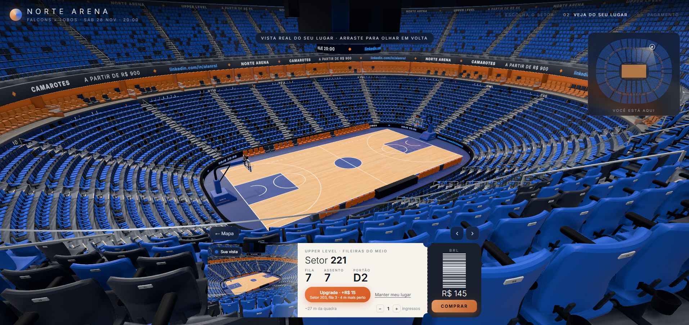

<h1 align="center">Olá, eu sou o Alan Lima 👋</h1>

  

  

---

## 🧑‍💻 Sobre mim

Sou **Analista de Dados** na área de **Inovação e Desenvolvimento**.

Gosto de trabalhar no ciclo completo de uma solução: entender o problema de negócio, modelar os dados, construir integrações e aplicações, automatizar processos e entregar informação que vira decisão.

- 🛠️ Aplicações web com **React**, **Node.js**, **PostgreSQL**, **Oracle** e **SQL**
- 🔗 Integrações via **APIs REST**, **Webhooks** e **WebSocket**
- 🌐 Criação de sites, blogs e landing pages com **WordPress**
- ⚙️ Automação de processos com **Python**, **n8n**, **Make** e **Power Automate**
- 📊 BI e indicadores gerenciais com **Power BI**

---

## 🛏️ Leitto

Comunicação entre o paciente no leito e a equipe do hospital, via QR code.

- 📱 Pedidos e chat pelo celular (PWA)
- ⚡ Chamados em tempo real com SLA
- 🏢 Multi-hospital (SaaS)
- 🔒 Auditoria e histórico imutável

  
  
  
  
  
  
  
  

---

## 🛒 AfiliWeb

Automação de ofertas de afiliados no WhatsApp e no Telegram. **[afiliweb.com.br](https://afiliweb.com.br)**

- 🔄 Captura a oferta e troca pelo link de afiliado
- ⏰ Fila com horários e regras de envio
- 🔌 Integra Mercado Livre e Amazon
- 📊 Painel com relatórios de envios e cliques

---

## 🏟️ Norte Arena

Venda de ingressos com visão 3D real do assento antes da compra.

- 🎥 Visão 3D do lugar, arrastando para olhar em volta
- 🗺️ Mapa interativo de setores
- ⬆️ Sugestão de upgrade de assento
- 🎟️ Fluxo de compra em 3 etapas

---

## 🚀 Outros projetos

| Projeto | O que é | Stack |
|---|---|---|
| ⛽ **Fuel Intelligence Brasil** | Preços de combustíveis com dados da ANP: ETL e indicadores | Python · PostgreSQL · Power BI |
| 🏥 **Gestão de Custos** | DRE gerencial e indicadores de custos hospitalares em app web | React · Oracle · SQL |
| 🛎️ **Care Connect** | Solicitações e avaliações de pacientes direto do quarto | React · APIs · Webhooks |

---

## 🧰 Linguagens e Tecnologias

  
  
  
  
  
  
  
  
  
  
  
  
  
  
  
  
  

  
  
  
  
  
  
  
  

---

## 📊 Estatísticas

  
  

---

  💬 Aberto a conversas sobre <b>dados, BI, engenharia de dados, automação e desenvolvimento</b>. 
  Me chama no <a href="https://www.linkedin.com/in/alanrsl">LinkedIn</a>!

